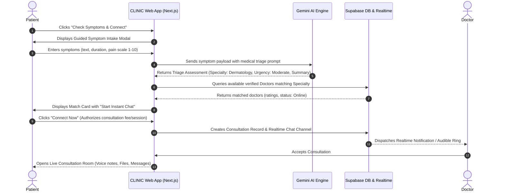

# CLINIC — Product Requirements Document (PRD)

---

## 1. Executive Summary & Vision

**Product Name:** CLINIC  
**Tagline:** Instant, Intelligent Healthcare at Your Fingertips.  
**Target Audience:** Patients seeking rapid medical triage and specialist consultations; licensed medical practitioners seeking flexible digital practice; and customers purchasing prescription and over-the-counter medical products.

### 1.1 Vision Statement
CLINIC bridges the gap between patient symptoms and certified medical specialists. By combining **Google Gemini AI** for intelligent symptom triage with a curated directory of verified doctors, CLINIC eliminates the guesswork in healthcare. In under 60 seconds, a patient can describe what they are experiencing, get intelligently matched with an available doctor, and enter a live, multi-modal consultation chat with voice notes, file sharing, and instant prescriptions—backed by an integrated digital pharmacy for door-to-door medication delivery.

### 1.2 Core Value Propositions
- **For Patients:** Zero friction. No endless scrolling through medical directories without knowing which specialist is needed. Immediate triage via Gemini AI, direct instant chat with a specialist, and one-click fulfillment of prescribed medications.
- **For Doctors:** Autonomy and high reach. Doctors manage their listings, digital consultation schedules, fee structures, verified credentials, and digital prescription issuance with automated billing.
- **For Healthcare Delivery:** Clean, accessible, mobile-first, and empathetic experience with strict medical emergency safeguards and privacy compliance.

---

## 2. Key Architecture & Technology Stack

| Layer | Technology | Rationale & Deployment |
| :--- | :--- | :--- |
| **Frontend Framework** | **Next.js (App Router, React 19)** | Server Components for instant SEO doctor directory indexing; Client Components for dynamic real-time consultation and cart interactions. |
| **Hosting & Edge Delivery**| **Vercel** | Handles both frontend rendering and backend Route Handlers / Server Actions running on Node.js runtime with edge caching and zero-config CI/CD. |
| **Database & Auth** | **Supabase (PostgreSQL + RLS)** | Production-ready Auth (JWT, email/password, OAuth, MFA), relational database with strict Row Level Security (RLS) for HIPAA-aligned patient data segregation. |
| **Object Storage** | **Supabase Storage** | Encrypted S3-compatible buckets for doctor verification documents (licenses), medical records, lab reports, chat images, voice audio files, and e-commerce product assets. |
| **Realtime Engine** | **Supabase Realtime (WebSockets)** | Sub-second latency for live 1-on-1 doctor-patient chat, active typing indicators, online presence, and incoming consultation alerts. |
| **AI Intelligence** | **Google Gemini AI (Gemini 2.0 Flash / 1.5 Pro via @google/genai)** | High-speed semantic extraction of clinical symptoms, urgent red-flag detection, medical specialty mapping, and structured doctor matching. |
| **Styling & Design System** | **Tailwind CSS + Vanilla CSS Tokens** | Strict typography rules using **Lexend** (primary) + **Plus Jakarta Sans** (secondary), custom healthcare color system, accessibility-first contrast. |
| **Animations** | **Framer Motion** | Micro-interactions, animated modal transitions, seamless chat message insertions, drawer sliding states, and smooth skeleton fallbacks without UI bloat. |

---

## 3. User Personas & User Journeys

### 3.1 Personas
1. **The Urgent/Anxious Patient (Sarah, 32):** Wakes up with acute abdominal pain and mild fever. Does not know whether to visit a gastroenterologist, general physician, or urgent care. Wants quick guidance, doesn't want to wait 3 weeks for an appointment.
2. **The Chronic Patient (David, 58):** Needs ongoing hypertension monitoring, periodic prescription refills, and convenient chat access to his cardiologist.
3. **The Certified Medical Specialist (Dr. Anya, 41 - Dermatologist):** Wants an intuitive platform to offer digital second opinions, view high-res patient skin images, listen to audio voice notes between clinics, and prescribe approved treatments.
4. **The Clinic Admin / Pharmacist (Michael, 36):** Manages pharmacy inventory, validates doctor prescriptions before dispatching medicines, and tracks order delivery statuses.

### 3.2 Primary User Flow: "Check Symptoms & Connect"


---

## 4. Feature Specifications

### 4.1 AI-Powered Symptom Intake & Doctor Matching Engine
Instead of the generic phrase *"Tell us how you feel"*, the system features high-converting, professional, and empathetic CTAs:
- **Primary Hero CTA:** `"Check Symptoms & Connect"`
- **Secondary / Supporting Micro-copy:** `"Describe how you feel in plain words. Our clinical AI matches you with the right verified specialist in under 60 seconds."`
- **Alternative High-Converting Badges:** `"Smart Symptom Triage"`, `"Instant Specialist Match"`.

#### 4.1.1 The Intake Modal (Step-by-Step Progressive Disclosure)
1. **Step 1: Description:** Freeform natural language input (`"I have had a throbbing migraine on the left side of my head for 2 days, accompanied by light sensitivity and nausea"`).
2. **Step 2: Key Vitals / Context:**
   - Duration (Hours, Days, Weeks)
   - Severity Slider (1 - Mild Discomfort to 10 - Unbearable Pain)
   - Who is this for? (Self, Child, Parent, Other)
   - Relevant existing conditions (e.g., Asthma, Hypertension, Diabetes, Pregnancy).
3. **Step 3: Emergency Red-Flag Screening (Safety First):**
   - Immediate rule-based and AI-based detection of critical emergencies (e.g., chest pain radiating to left arm, sudden facial drooping/slurred speech, severe hemorrhaging, acute difficulty breathing, suicidal ideation).
   - *Emergency Trigger Action:* Bypasses standard matching immediately; renders a high-visibility Emergency Warning Modal directing the user to dial local emergency numbers (e.g., 911 / 112 / local ER) with one-tap dialing and a nearby ER locator.
4. **Step 4: Gemini AI Analysis:**
   - Analyzes semantic intent and clinical taxonomy.
   - Outputs structured JSON containing:
     - `primary_specialty_recommended` (e.g., `"Neurology"`)
     - `secondary_specialty_recommended` (e.g., `"General Practice"`)
     - `urgency_level` (`"Routine" | "Urgent" | "Critical Emergency"`)
     - `clinical_summary` (Plain language summary for the patient and technical clinical summary for the doctor)
     - `suggested_clarification_questions` (For the doctor to ask)
5. **Step 5: Automated Doctor Recommendation & Match Popup:**
   - Displays top 3 matched verified doctors with badges (`"Top Match"`, `"Available Now"`, `"Fast Responder"`).
   - Shows doctor photo, full name, hospital affiliation, years of experience, rating (e.g., 4.9 ★ - 140 reviews), and consultation fee.
   - Primary Action: `"Start Instant Consultation"` opens the direct chat modal/room immediately.
   - Secondary Action: `"View Full Profile"` or `"Browse Other Neurologists"`.

---

### 4.2 Doctor Directory, Profiles & Verification Lifecycle

#### 4.2.1 Zero-Dummy Profiles & Search Standards
- **Strict Real-Data Policy:** The platform strictly prohibits dummy, fake, or hardcoded doctor profiles. Every doctor displayed in the directory, search results, and AI recommendations is pulled directly from the Supabase database.
- **Verification Gating:** Only doctors with `is_verified = true` (vetted and approved by an administrator in `/admin`) are listed publicly.
- **Dynamic Category & Specialty Search:**
  - Real-time filtering by dynamic medical categories present in the database (General Practice, Cardiology, Dermatology, Pediatrics, Neurology, etc.).
  - Search bar supporting debounced queries across doctor names, hospital affiliations, conditions treated, and sub-specialties.

#### 4.2.2 Doctor Onboarding & License Submission Flow (`/doctor/onboarding`)
- **Signup & Role Selection:** When signing up, users choose between `Patient` and `Doctor`.
  - **Patients:** Instantly authenticated and redirected directly to their dashboard/home.
  - **Doctors:** Redirected to the comprehensive credential onboarding screen (`/doctor/onboarding`).
- **Required Doctor Submissions:**
  - Professional title, specialty, and sub-specialty tags.
  - Medical license registration number.
  - **License Document Upload:** Mandatory upload of medical council license (PDF, JPG, PNG) stored in private Supabase Storage (`doctor-credentials`).
  - Hospital affiliation, years of experience, narrative bio, and per-session consultation fee.
- **Awaiting Approval Status Screen:**
  - Upon submission, the doctor's account is marked `is_verified = false`.
  - The doctor sees a prominent status card: *"Awaiting approval, you will get notified"*.
  - Account remains restricted until verified by an administrator.

#### 4.2.3 Administrative Verification Portal (`/admin`) & Resend Email Integration
- **Admin Verification Dashboard (`/admin`):**
  - Secure portal accessible exclusively to users with `role = 'admin'`.
  - Lists all pending doctor applications with their submitted credentials, hospital affiliation, and years of experience.
  - **License Inspection:** Secure preview/download of the doctor's uploaded medical license document.
  - **Approval Action:** Clicking `"Approve Doctor"` sets `is_verified = true` in Supabase.
  - **Resend Email Notification:** System immediately triggers an automated, branded transactional email via **Resend** to the doctor's email address notifying them that their license has been approved and their CLINIC profile is now live.

#### 4.2.4 Public Doctor Directory Listing (`/doctors`)
- **Dynamic Filters:** Specialty pills, availability status (Online Now vs. Offline), fee range, rating.
- **Doctor Card Anatomy:**
  - Verified Credential Badge (Medical Council License Verified)
  - Live Status Indicator (🟢 Online & Ready to Chat, ⚪ Offline)
  - Full Name, Credentials (MD, FACP, MBBS)
  - Specialty, Hospital Affiliation, Experience, Rating
  - Consultation Fee & `"Start Chat"` CTA.

#### 4.2.5 Comprehensive Doctor Profile (`/doctors/[slug]`)
- **Hero Header:** Portrait, verified badge, consultation count, average response time (`< 3 mins`).
- **Bio & Philosophy of Care:** Treatment philosophy and background.
- **Education & Board Certifications:** Medical school, residency, verified license number.
- **Specializations & Conditions Treated:** Interactive pill tags.
- **Verified Patient Reviews:** Authenticated reviews from real consultations.
- **Sticky Booking / Chat Bar (Mobile & Desktop).**


---

### 4.3 Patient Portal & Profile (`/patient/profile`)

- **Personal Demographics:** Full name, DOB, blood group, biological sex, emergency contact information.
- **Medical Vault:**
  - Allergies list (Drug allergies, food, environmental)
  - Chronic conditions & Past Surgeries
  - Uploaded Lab Reports & Diagnostic Scans (PDF / PNG / DICOM viewer integration with Supabase Storage)
- **Consultation History:**
  - Log of all past and ongoing doctor chats
  - Downloadable PDF consultation summaries and doctor-signed digital prescriptions
- **Pharmacy Orders Tab:** Real-time tracking of ordered prescription and OTC items, order status (Processing, Packed, Out for Delivery, Delivered).
- **Privacy & Security Settings:** Two-factor authentication (2FA), data export (GDPR/HIPAA right to access), active session management.

---

### 4.4 Rich Multi-Modal Consultation Chat System

The consultation chat is the operational heart of CLINIC. It must feel as seamless, reliable, and expressive as WhatsApp or Telegram, while maintaining clinical confidentiality.

#### 4.4.1 Chat Capabilities & Features
1. **Real-time Messaging:** Instant message dispatch with Supabase Realtime (latency < 200ms).
2. **Message Delivery States:** Single check (Sent), Double check (Delivered), Double Blue check (Read).
3. **Typing Indicators & Presence:** `"Dr. Anya is typing..."` and active online presence pulses.
4. **Voice Notes (Audio Messages):**
   - One-tap audio recording with live waveform visualizer.
   - Pause, preview, cancel, and send functionality.
   - Built-in audio player with play/pause, variable playback speeds (`1.0x`, `1.5x`, `2.0x`), and interactive seek scrubber.
   - Audio files stored securely in Supabase Storage with signed temporary URLs.
5. **Image Attachments:**
   - Inline drag-and-drop or camera snap for symptoms (e.g., rashes, swelling, eye redness).
   - In-app lightbox image previewer with pinch-to-zoom and pan.
6. **File & Lab Report Sharing:**
   - Upload PDF, DOCX, DICOM reports up to 25MB.
   - File icon preview with file name, size, and download button.
7. **Interactive Emoji Picker:** Lightweight, accessible emoji popover for quick emotional expression and reassurance.
8. **Clinical Action Bar (Doctor View Only):**
   - **`"Issue Digital Prescription"`:** Opens an integrated modal to prescribe drug, dosage, frequency, duration, and instructions.
   - **`"Request Lab Test"`:** Sends structured diagnostic lab request card directly into the chat.
   - **`"Complete Consultation"`:** Generates consultation summary and archive record.
9. **Patient Prescription Card in Chat:**
   - When doctor issues a prescription, it renders as an interactive card in the chat stream.
   - Patient can click **`"Add All Prescribed Medicines to Cart"`** with a single tap, seamlessly bridging the chat into the e-commerce pharmacy!

---

### 4.5 Integrated E-Commerce & Digital Pharmacy

The pharmacy section enables patients to purchase both over-the-counter (OTC) wellness products and doctor-prescribed medications.

#### 4.5.1 Product Catalog & Listing (`/pharmacy`)
- **Category Taxonomy:**
  - Prescription Medications (Requires valid prescription upload or link to doctor consultation)
  - Over-the-Counter (Pain Relief, Cold & Flu, Allergy, Digestive Health)
  - Vitamins & Dietary Supplements
  - First Aid & Medical Devices (Blood pressure monitors, thermometers, oximeters)
  - Personal Care & Dermatology
- **Filters & Sorting:** Price range, brand, dosage form (Tablets, Syrup, Cream, Drops), rating, in-stock only.
- **Search:** Auto-complete search with instant product thumbnails and generic molecule matching.

#### 4.5.2 Single Product Details Page (`/pharmacy/[slug]`)
- **Product Gallery:** High-definition multi-angle images with thumbnail selector and zoom.
- **Key Badges:** `"Prescription Required"` (Rx badge) or `"Over The Counter"`, FDA/National Drug Authority approved badge.
- **Pricing & Stock:** Unit price, pack sizes (e.g., 30 Tablets, 60 Tablets), stock status.
- **Detailed Clinical Information (Accordion/Tabs):**
  - Active Ingredients & Strength (e.g., Ibuprofen 400mg)
  - Indications & Usage
  - Recommended Dosage & Administration
  - Side Effects & Warnings
  - Storage Conditions
- **Prescription Upload Widget:** If the item is an Rx drug, an inline file upload or `"Attach from CLINIC Consultation"` selector is mandatory before checkout.
- **Add to Cart & Sticky Mobile Buy Bar.**

#### 4.5.3 Shopping Cart (`/cart` & Slide-over Drawer)
- Real-time cart drawer accessible from any page.
- Item quantity increments/decrements with optimistic UI updates.
- Validation warning if any cart item requires a prescription that has not been attached.
- Free shipping progress bar (e.g., `"Add $12.00 more for Free Express Delivery"`).
- Estimated tax and subtotal calculation.

#### 4.5.4 Checkout & Order Completion (`/checkout`)
- **Step 1: Shipping Address:** Saved addresses or new address input with Google Places autocomplete.
- **Step 2: Prescription Verification:** Summarizes attached prescriptions; pharmacist review SLA indicated (e.g., `"Pharmacist approval within 15 minutes"`).
- **Step 3: Delivery Options:** Standard Delivery (1-2 days) vs. Rapid Local Delivery (under 2 hours for urgent medications).
- **Step 4: Payment Processing:** Stripe / Card / Apple Pay / Google Pay integration with encrypted payment forms.
- **Step 5: Order Confirmation (`/orders/[id]`):** Live visual stepper tracking order progress (Order Placed -> Pharmacist Review -> Dispensed -> Out for Delivery -> Delivered).

---

## 5. UI/UX Design System & Mobile Responsiveness

### 5.1 Design Philosophy: Simplicity, Empathy & Clarity
Patients visiting CLINIC may be in pain, anxious, or stressed. The interface must be **calm, clean, reassuring, and completely devoid of cognitive clutter**.
- **No overly complex layouts:** Generous whitespace, soft rounded corners (`rounded-2xl`, `rounded-3xl`), legible visual hierarchy.
- **Medical Color Palette:**
  - Primary Brand: Deep Clinical Teal / Cyan (`#0D9488` / `#0F766E` / Tailwind `teal-600` / `teal-700`) — conveys trustworthiness, clinical precision, and calm.
  - Secondary Accent: Soft Sky Blue (`#0284C7` / Tailwind `sky-600`) — energetic and reassuring.
  - Background Neutral: Crisp Pure White (`#FFFFFF`) with subtle cool-tinted grays (`#F8FAFC` slate-50, `#F1F5F9` slate-100).
  - Dark Mode Support: Deep Slate Charcoal (`#0B1120`, `#1E293B`) for comfortable night-time consultation without glare.
  - Emergency / Warning: Crimson Red (`#DC2626` rose-600) strictly reserved for critical alerts and urgent red-flags.
  - Success / Online: Emerald Green (`#10B981` emerald-500) for online badges, active states, and successful transactions.

### 5.2 Typography System
- **Primary Font:** **`Lexend`** (Google Fonts)
  - *Why Lexend:* Specifically engineered based on research to reduce visual stress, reduce cognitive load, and improve reading speed. Perfect for clinical readability, patient symptom forms, and critical instructions.
- **Secondary UI Font:** **`Plus Jakarta Sans`** or **`Inter`**
  - *Why Plus Jakarta Sans:* Exceptionally crisp, modern geometric sans-serif for compact tabular data, product specs, chat metadata, and tiny timestamps.

### 5.3 Mobile-First Rules
- Over 75% of telemedicine chats occur on smartphones.
- Mobile bottom navigation bar for quick access (`Home`, `Doctors`, `Pharmacy`, `My Chats`, `Profile`).
- Chat interface accounts for mobile virtual keyboard pop-ups using `dvh` (Dynamic Viewport Height) so message input is never hidden.
- Modals on mobile automatically translate into smooth bottom sheets (swipeable to dismiss).
- Minimum touch targets of 48px × 48px on all interactive elements.

### 5.4 Framer Motion Animation Guidelines
- Purposeful micro-animations only: gentle fade-ins (`opacity: 0` to `1`, duration: 0.25s), subtle spring-based slide-ups for bottom sheets and chat modals.
- Staggered entrance for doctor search result cards (`staggerChildren: 0.05`).
- Waveform bounce for voice note recording.
- No heavy, disorienting 3D animations or lag-inducing transitions.

---

## 6. Database Schema & Data Models (Supabase PostgreSQL)

```sql
-- Enable necessary extensions
create extension if not exists "uuid-ossp";

-- 1. USERS & PROFILES
create type user_role as enum ('patient', 'doctor', 'pharmacist', 'admin');

create table public.profiles (
    id uuid references auth.users on delete cascade primary key,
    role user_role default 'patient' not null,
    full_name text not null,
    email text unique not null,
    phone text,
    avatar_url text,
    created_at timestamptz default now() not null,
    updated_at timestamptz default now() not null
);

-- 2. DOCTOR DETAILS
create table public.doctor_profiles (
    id uuid primary key default uuid_generate_v4(),
    profile_id uuid references public.profiles(id) on delete cascade unique not null,
    specialty text not null,
    sub_specialties text[] default '{}',
    medical_license_number text not null,
    is_verified boolean default false not null,
    hospital_affiliation text,
    years_of_experience int default 0,
    bio text,
    consultation_fee numeric(10, 2) default 0.00 not null,
    currency text default 'USD' not null,
    is_online boolean default false not null,
    average_rating numeric(3, 2) default 5.00,
    total_reviews int default 0,
    created_at timestamptz default now() not null
);

-- 3. PATIENT MEDICAL RECORDS
create table public.patient_medical_vault (
    id uuid primary key default uuid_generate_v4(),
    patient_id uuid references public.profiles(id) on delete cascade unique not null,
    blood_group text,
    allergies text[] default '{}',
    chronic_conditions text[] default '{}',
    emergency_contact_name text,
    emergency_contact_phone text,
    updated_at timestamptz default now() not null
);

-- 4. CONSULTATIONS & AI TRIAGE
create type triage_urgency as enum ('routine', 'moderate', 'urgent', 'critical_emergency');
create type consultation_status as enum ('pending_match', 'active', 'completed', 'cancelled');

create table public.consultations (
    id uuid primary key default uuid_generate_v4(),
    patient_id uuid references public.profiles(id) on delete cascade not null,
    doctor_id uuid references public.doctor_profiles(id) on delete set null,
    raw_symptoms text not null,
    pain_level int check (pain_level between 1 and 10),
    symptom_duration text,
    ai_urgency triage_urgency default 'routine',
    ai_recommended_specialty text,
    ai_triage_summary text,
    status consultation_status default 'pending_match' not null,
    created_at timestamptz default now() not null,
    ended_at timestamptz
);

-- 5. REALTIME CHAT MESSAGES
create type message_type as enum ('text', 'audio', 'image', 'file', 'prescription', 'system');

create table public.chat_messages (
    id uuid primary key default uuid_generate_v4(),
    consultation_id uuid references public.consultations(id) on delete cascade not null,
    sender_id uuid references public.profiles(id) on delete cascade not null,
    message_type message_type default 'text' not null,
    content text, -- Text message content or system string
    attachment_url text, -- Storage link for voice audio, image, or PDF
    attachment_metadata jsonb default '{}'::jsonb, -- e.g. duration for audio, file name, size
    is_read boolean default false not null,
    created_at timestamptz default now() not null
);

-- 6. PRESCRIPTIONS
create table public.prescriptions (
    id uuid primary key default uuid_generate_v4(),
    consultation_id uuid references public.consultations(id) on delete cascade not null,
    doctor_id uuid references public.doctor_profiles(id) on delete cascade not null,
    patient_id uuid references public.profiles(id) on delete cascade not null,
    diagnosis text not null,
    medications jsonb not null, -- Array of [{ name, dosage, frequency, duration, instructions, pharmacy_product_id }]
    doctor_notes text,
    pdf_url text,
    created_at timestamptz default now() not null
);

-- 7. E-COMMERCE PRODUCTS
create table public.products (
    id uuid primary key default uuid_generate_v4(),
    name text not null,
    slug text unique not null,
    category text not null,
    description text not null,
    price numeric(10, 2) not null,
    stock_quantity int default 0 not null,
    requires_prescription boolean default false not null,
    image_url text not null,
    gallery_images text[] default '{}',
    dosage_form text, -- e.g. 'Tablet', 'Ointment'
    active_ingredients text,
    rating numeric(3, 2) default 5.00,
    created_at timestamptz default now() not null
);

-- 8. E-COMMERCE ORDERS & ITEMS
create type order_status as enum ('pending', 'pharmacist_review', 'processing', 'shipped', 'delivered', 'cancelled');

create table public.orders (
    id uuid primary key default uuid_generate_v4(),
    patient_id uuid references public.profiles(id) on delete cascade not null,
    total_amount numeric(10, 2) not null,
    status order_status default 'pending' not null,
    shipping_address jsonb not null,
    attached_prescription_id uuid references public.prescriptions(id) on delete set null,
    payment_status text default 'paid',
    created_at timestamptz default now() not null
);

create table public.order_items (
    id uuid primary key default uuid_generate_v4(),
    order_id uuid references public.orders(id) on delete cascade not null,
    product_id uuid references public.products(id) on delete restrict not null,
    quantity int not null,
    unit_price numeric(10, 2) not null
);
```

---

## 7. Gemini AI Integration Specification

### 7.1 Model & Configuration
- **Model:** `gemini-2.0-flash` (or `gemini-1.5-flash` for ultra-low latency sub-second responses).
- **Format:** Structured JSON Mode via system instruction schema.
- **Safety Settings:** Strict medical disclaimer injection; high threshold for blocking hate/harassment; specialized rule to identify acute self-harm or medical emergencies.

### 7.2 Prompt Schema & Triage Directive
```typescript
export const GEMINI_TRIAGE_SYSTEM_PROMPT = `
You are CLINIC AI, an empathetic, highly trained clinical triage assistant.
Your job is to analyze patient symptoms, screen for acute life-threatening emergencies, determine the most appropriate medical specialty, and formulate a concise clinical summary for both patient and doctor.

CRITICAL INSTRUCTIONS:
1. EMERGENCY DETECTION: If symptoms indicate heart attack, stroke, acute respiratory distress, anaphylaxis, severe hemorrhage, or suicidal thoughts, set urgency to "critical_emergency" immediately.
2. STRUCTURED SPECIALTY: Map symptoms strictly to verified medical specialties:
   ["General Practice", "Cardiology", "Dermatology", "Pediatrics", "Neurology", "Psychiatry", "Gynecology", "Orthopedics", "Ophthalmology", "ENT", "Gastroenterology", "Urology", "Endocrinology"].
3. NEVER prescribe medications or give definitive diagnoses. Provide triage guidance and specialty routing only.
4. Output STRICT JSON conforming to the requested schema.
`;
```

---

## 8. Security, Privacy & Regulatory Compliance

1. **HIPAA & GDPR Principles:**
   - Database tables containing Protected Health Information (PHI) have Supabase Row Level Security (RLS) enabled.
   - Patients can only view their own consultations, medical vault records, and orders.
   - Doctors can only view consultation records and vaults for patients who have actively entered a consultation with them.
2. **Supabase Storage Access:**
   - Patient lab uploads and voice notes are stored in private buckets.
   - Files are accessed only via short-lived signed URLs (TTL: 15–60 minutes).
3. **Doctor Verification Workflow:**
   - Doctor accounts start in `is_verified = false`.
   - Admin review portal verifies license registration with the state/national medical registry before listing doctors publicly.

---

## 9. Success Metrics & KPIs

| Metric | Target | Method of Tracking |
| :--- | :--- | :--- |
| **Symptom-to-Match Time** | `< 45 seconds` | Event analytics from modal submit to doctor match popup |
| **Consultation Connection Rate** | `> 85%` | Patients who trigger instant chat and connect with a doctor |
| **Average First Response Time** | `< 3 minutes` | Time from doctor chat channel created to doctor's first message |
| **Prescription to Pharmacy Conversion** | `> 40%` | Patients who click "Add Prescribed Medicines to Cart" |
| **Cart Checkout Completion** | `> 65%` | Funnel tracking on `/checkout` |
| **Mobile Usability Score** | `> 95/100` | Google Lighthouse Mobile performance & accessibility audit |

---

## 10. Phased Implementation Roadmap

- **Phase 1: Core Design System & Authentication (Week 1)**
  - Lexend + Plus Jakarta Sans typography, Tailwind CSS setup, Supabase Auth (Patient & Doctor registration).
- **Phase 2: Gemini AI Triage Engine & Doctor Directory (Week 2)**
  - Symptom intake modal, Gemini API route handler, doctor search & filter catalog, doctor profile page.
- **Phase 3: Real-Time Multi-Modal Chat (Week 3)**
  - Supabase Realtime channels, voice note recording & playback, image/PDF upload, emoji picker, digital prescription generation.
- **Phase 4: Pharmacy E-Commerce & Checkout (Week 4)**
  - Product catalog, single product page, prescription attach flow, cart drawer, checkout & order tracking.
- **Phase 5: Safety Guardrails, Polish & Deployment (Week 5)**
  - Framer motion polish, mobile keyboard optimization, emergency red-flag safeguards, Vercel production deployment.
