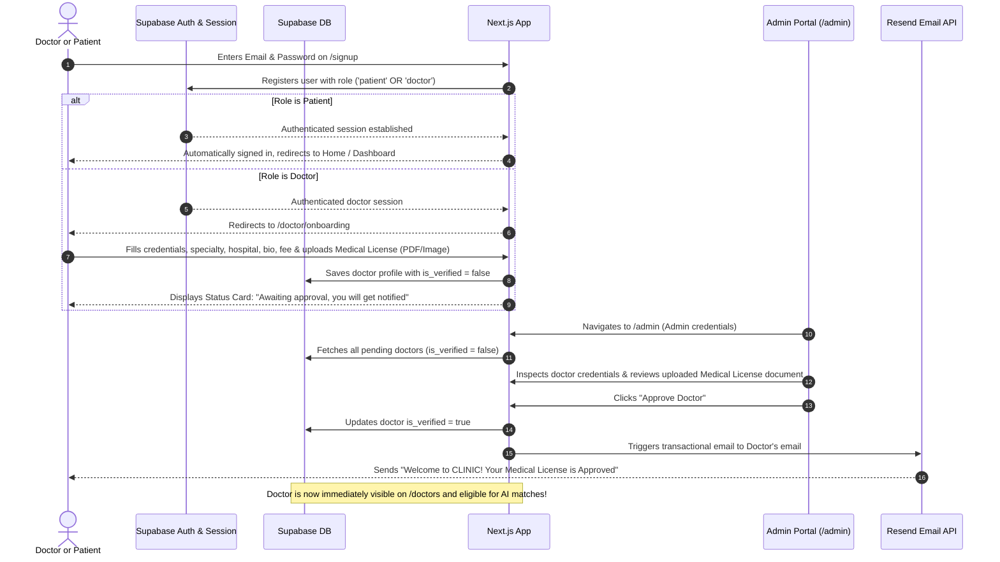

# CLINIC — Doctor Onboarding, Admin Verification & Resend Notifications

## 1. Zero Dummy Profiles Principle
- **Absolute Rule:** The CLINIC UI **must never display mock, fake, or hardcoded dummy doctor profiles**.
- All doctor listings on `/doctors`, search results, and Gemini AI triage matches are fetched **live from the Supabase database**.
- Only doctors whose `is_verified` column is strictly `true` (approved by an administrator in `/admin`) will be displayed in the public directory and considered for AI matching.

---

## 2. Authentication & Role-Based Onboarding Flow

---

## 3. Detailed Doctor Onboarding Specification (`/doctor/onboarding`)

### 3.1 Form Fields & Verification Artifacts
1. **Full Professional Name & Title:** (e.g., Dr. Marcus Vance, MD, FACP)
2. **Medical Specialty & Sub-specialties:**
   - Dropdown selection mapped to clinical taxonomy: `Cardiology`, `Dermatology`, `Pediatrics`, `Neurology`, `Psychiatry`, `General Practice`, `Orthopedics`, `ENT`, `Gastroenterology`, `Gynecology & Obstetrics`, `Ophthalmology`, `Urology`, `Endocrinology`, `Pulmonology`.
   - Sub-specialty tags (e.g. Pediatric Cardiology, Acne Scar Revision, Epilepsy).
3. **Medical Council License Number:** (e.g., `MED-LIC-2024-88392`)
4. **License Document Upload (Mandatory):**
   - Secure drag-and-drop file uploader accepting `PDF`, `PNG`, `JPG`.
   - Stored in private Supabase Storage bucket: `doctor-credentials/[user_id]/license.[ext]`.
   - Admin accesses via short-lived signed URL for verification review.
5. **Hospital / Clinic Affiliation:** (e.g., Johns Hopkins Hospital, St. Jude Medical)
6. **Years of Active Clinical Experience:** Numeric input (e.g., 12)
7. **Professional Bio & Philosophy of Care:** Narrative textarea.
8. **Consultation Pricing:**
   - Currency: USD (or local currency).
   - Rate per consultation chat: (e.g., $45.00).

### 3.2 "Awaiting Approval" Screen
Once submitted, the doctor's route `/doctor/dashboard` or `/doctor/onboarding` renders an empathetic, locked status view:
- **Badge:** `Pending Administrative Review` (Amber pulse)
- **Title:** *"Application Submitted — Awaiting Approval"*
- **Message:** *"Our medical credentials committee is verifying your medical license and hospital affiliations. You will receive an email notification once your profile is approved."*
- **Contact Support CTA:** Link to administrative support in case of urgent expedited reviews.

---

## 4. Admin Portal Specification (`/admin`)

### 4.1 Route & Access Control
- URL: `/admin`
- Security: Protected by Next.js middleware and Supabase RLS policies. Only users with `role = 'admin'` can access this dashboard.

### 4.2 Admin Dashboard Capabilities
1. **Platform Metrics Overview:**
   - Total Verified Doctors Live
   - Pending Doctor Approvals
   - Active Consultations Today
   - Pharmacy Orders Needing Pharmacist Review
2. **Doctor Verification Queue (`/admin/doctors`):**
   - Table / Card view of pending doctor applications.
   - Doctor card shows:
     - Avatar & Name
     - Specialty & Years of Experience
     - Hospital Affiliation
     - License Number
     - **"View Medical License" button:** Opens high-resolution document in a secure lightbox or new tab using a signed URL.
   - Action Buttons:
     - **`Approve Doctor` (Green):** Updates `is_verified: true` in Supabase, triggers Resend transactional approval email.
     - **`Reject / Request Info` (Red/Amber):** Prompts for reason (e.g., blurry license photo, expired credentials) and emails the doctor.
3. **Directory Moderation:**
   - Ability to suspend or re-verify doctors at any time.

---

## 5. Resend Email Integration Protocol

### 5.1 Architecture
- Email Service: **Resend** via API (`resend` npm package).
- Server-side execution in Next.js Route Handler (`/api/admin/approve-doctor`).
- API Key: `RESEND_API_KEY` stored securely in environment variables.

### 5.2 Approval Email Template
- **Sender:** `CLINIC Credentialing Team <no-reply@clinic.health>` (or verified domain)
- **Subject:** `🎉 Your CLINIC Medical Practice is Approved!`
- **Content Structure:**
  - Header with official CLINIC teal branding
  - Salutation: `Dear Dr. [Doctor Full Name],`
  - Body: *"We have successfully verified your medical license ([License Number]). Your CLINIC profile is now active and listed on our public directory. Patients can now be matched with you via AI symptom triage."*
  - CTA Button: `[Go to Doctor Consultation Dashboard]`
  - Footer with medico-legal disclaimers and provider support contact.

---

## 6. Doctor Search & Category Filtering Rules

On the public `/doctors` page:
1. **Dynamic Category Pills:**
   - Filter pills generated dynamically based on active specialties in the database: `All`, `General Practice`, `Dermatology`, `Cardiology`, `Pediatrics`, `Neurology`, etc.
2. **Debounced Search Input:**
   - Search query matches against doctor `full_name`, `specialty`, `sub_specialties`, and `hospital_affiliation`.
3. **Filter by Availability:**
   - Toggle: `Online Now` (filters where `is_online = true`).
4. **Sort Options:**
   - `Highest Rated` (Default: `average_rating DESC`)
   - `Most Experienced` (`years_of_experience DESC`)
   - `Price: Low to High` (`consultation_fee ASC`)
   - `Price: High to Low` (`consultation_fee DESC`)
5. **No Placeholders / Fallbacks:**
   - If no doctors match the criteria, show an empathetic empty state: *"No verified doctors currently found matching this specialty. Try adjusting your filters or use our AI Symptom Triage to find care."*
