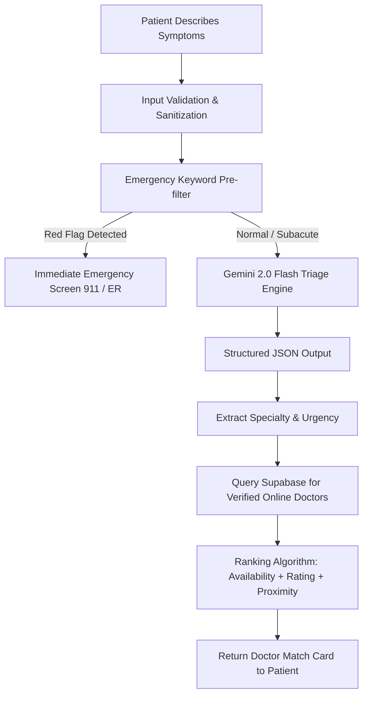

# CLINIC — Gemini AI Symptom Triage & Doctor Matching Rules

## 1. Overview & Architectural Role

CLINIC leverages **Google Gemini AI** (using `@google/genai` with `gemini-2.0-flash`) as an intelligent, empathetic medical triage and doctor matching engine. 
The AI does **not** deliver automated diagnoses or prescribe treatment independently; its mission is to **accurately parse unstructured patient symptoms, screen for acute emergencies, route to the correct medical specialty, and match the patient to the best available verified doctor.**

---

## 2. Gemini AI Integration Pipeline



---

## 3. Gemini System Prompt & Structured Output

### 3.1 Prompt Configuration
- **Model:** `gemini-2.0-flash`
- **Temperature:** `0.2` (Low temperature for consistent, clinically grounded determinism)
- **TopP:** `0.8`
- **Response Format:** `application/json`

### 3.2 System Prompt Directive
```typescript
export const GEMINI_TRIAGE_SYSTEM_INSTRUCTION = `
You are CLINIC AI, a specialized clinical triage and doctor-matching intelligence.
Your task is to analyze patient symptom descriptions, evaluate clinical urgency, determine the appropriate medical specialty, and generate summaries for both the patient and the physician.

STRICT CLINICAL RULES:
1. EMERGENCY DETECTION (SAFETY FIRST):
   - You MUST classify urgency as "critical_emergency" if symptoms match any of the following:
     * Acute chest pain, pressure radiating to jaw, neck, or left arm
     * Sudden severe shortness of breath or cyanosis
     * Signs of stroke (FAST: facial drooping, arm weakness, slurred speech)
     * Severe uncontrollable hemorrhaging
     * Sudden loss of consciousness or severe neurological deficit
     * Acute anaphylaxis (throat swelling, tongue swelling, hives, wheezing)
     * Active suicidal or homicidal intent with means
   - In "critical_emergency", emergency_instructions MUST provide clear immediate direction to call emergency services.

2. SPECIALTY MAPPING:
   - Map symptoms strictly to one of our verified platform specialties:
     ["General Practice", "Cardiology", "Dermatology", "Pediatrics", "Neurology", 
      "Psychiatry", "Gynecology & Obstetrics", "Orthopedics", "Ophthalmology", 
      "ENT (Otolaryngology)", "Gastroenterology", "Urology", "Endocrinology", "Pulmonology"]

3. CLINICAL SUMMARIES:
   - patient_friendly_summary: Reassuring, clear, free of complex jargon, under 40 words.
   - physician_clinical_note: Concise SOAP-style triage note for the doctor under 60 words.

4. YOU MUST RETURN VALID JSON ONLY, MATCHING THE PROVIDED JSON SCHEMA.
`;
```

### 3.3 TypeScript JSON Schema for Gemini Output
```typescript
export interface GeminiTriageResponse {
  urgency: 'routine' | 'moderate' | 'urgent' | 'critical_emergency';
  primary_specialty: string;
  secondary_specialty?: string;
  confidence_score: number; // 0.0 to 1.0
  is_emergency: boolean;
  emergency_instructions?: string;
  patient_friendly_summary: string;
  physician_clinical_note: string;
  suggested_doctor_questions: string[];
}
```

---

## 4. Doctor Matching & Ranking Algorithm

Once Gemini outputs the recommended specialty (e.g., `"Dermatology"`), the matching engine executes a scoring query against Supabase PostgreSQL:

```typescript
export interface DoctorScoreFactors {
  is_online: boolean;        // Weight: 40 points
  specialty_exact_match: boolean; // Weight: 30 points
  rating_score: number;       // Weight: 15 points (5.0 * 3)
  response_time_under_5m: boolean; // Weight: 10 points
  sub_specialty_match: boolean;    // Weight: 5 points
}
```

### Ranking Formula:
$$\text{Match Score} = (S_{\text{online}} \times 40) + (S_{\text{specialty}} \times 30) + (R \times 3) + (S_{\text{speed}} \times 10) + (S_{\text{sub}} \times 5)$$

- Doctors with `is_online = true` are prioritized at the top of the recommendation modal.
- If no specialist is online in the exact field, the system automatically falls back to an online **General Practice** doctor who can provide immediate initial triage and refer if needed.

---

## 5. Failure Handling & Redundancy

1. **Gemini API Timeout / Rate Limit Fallback:**
   - Set maximum fetch timeout of `4000ms`.
   - If Gemini API fails or times out, seamlessly switch to a local rule-based keyword classifier (mapping keywords like `"rash"`, `"headache"`, `"stomach"` to specialties) so the patient is never stranded without assistance.
2. **Disclaimer Enforcement:**
   - Every AI result displayed to the patient must include:
     > *"CLINIC AI provides clinical triage to connect you with a physician. It is not a substitute for a licensed doctor's diagnosis."*
3. **Audit Logging:**
   - Every AI triage request and response is stored in `consultations` table for clinical quality assurance and prompt performance tuning.
